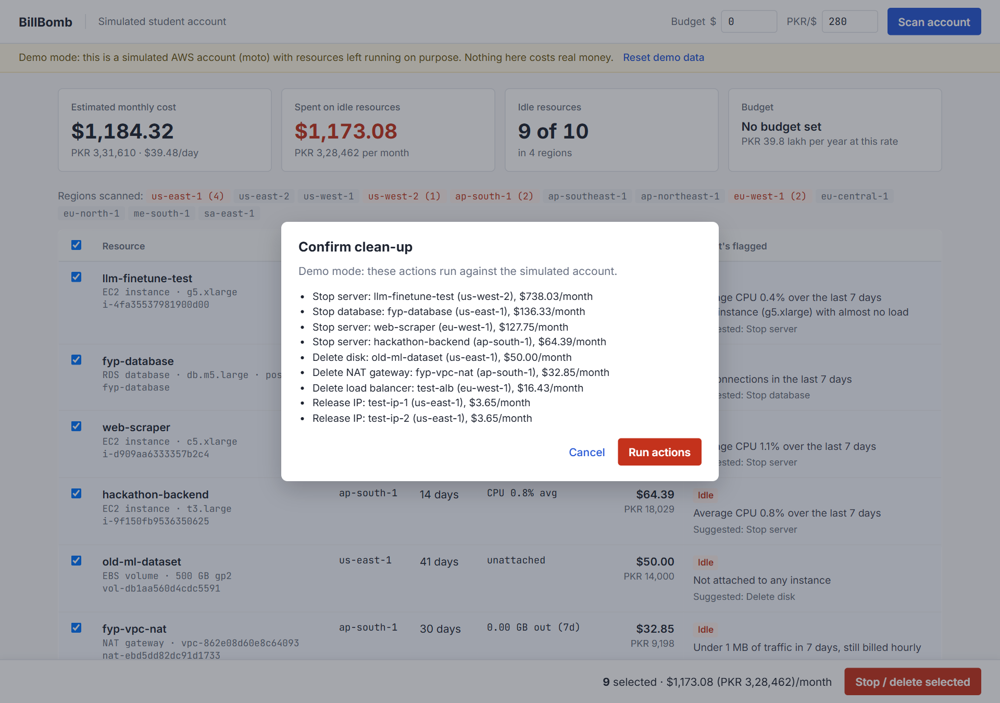
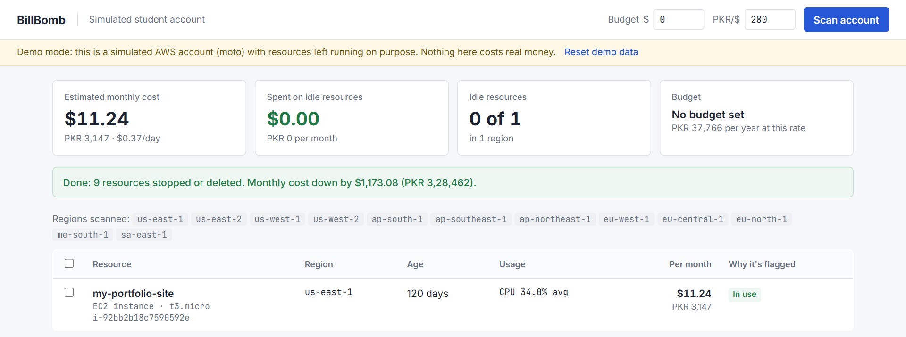

# BillBomb

[](https://github.com/zaynabtauqeer/billbomb/actions/workflows/tests.yml)

[](LICENSE)

**Find forgotten AWS resources before they turn into a surprise bill.**

BillBomb scans every region of an AWS account, lists everything that is costing money, checks real usage to
find what nobody is using, and stops or deletes it after you confirm. Costs are shown per month in USD and PKR.


---

## Contents

- [Why](#why)
- [Features](#features)
- [How idle resources are detected](#how-idle-resources-are-detected)
- [Quick start](#quick-start)
- [Using a real AWS account](#using-a-real-aws-account)
- [Auto-stop template](#auto-stop-template)
- [Architecture](#architecture)
- [Testing](#testing)
- [Limitations](#limitations)
- [Related tools](#related-tools)
- [Roadmap](#roadmap)
- [Contributing](#contributing)
- [License and acknowledgements](#license-and-acknowledgements)

## Why

AWS bills by the hour, and it is easy to leave something running. A developer on Hacker News wrote in 2026:

> "launched a big AWS EC2 instance alongside AWS Bedrock... 2 weeks later, a bill for ~$1,700 showed up."
> ([source](https://news.ycombinator.com/item?id=48528779))

For a student in Pakistan, $1,700 is roughly PKR 4.7 lakh. It happens often because:

- AWS has more than 30 regions and the console shows one at a time, so a resource left in another region is easy to lose.
- New users assume the free tier covers everything. NAT gateways, Elastic IPs, GPU instances and most databases are not free.
- AWS Budgets alerts after money is spent and does not say which resource to turn off.

BillBomb is built for students, freelancers, hackathon teams and small startups who manage their own account.

## Features

- **Scans all regions in parallel** for EC2 instances, EBS volumes and snapshots, Elastic IPs, NAT gateways,
  Application/Network Load Balancers and RDS databases.
- **Checks real usage** using the last 7 days of CloudWatch data before marking anything idle. New or busy resources are not flagged.
- **Shows the cost** of each resource and the account total per month, per day and per year, in USD and PKR, with an optional monthly budget.
- **Cleans up safely.** You select resources and confirm a list of exact actions. On a real account you must also type `DEFUSE`.
- **Auto-stop template** (CloudFormation) that stops instances and databases every night and emails you near your budget.
- **Demo mode** with a simulated AWS account, so you can try everything without an AWS account or any charges.

| Confirm before anything changes | After clean-up |
|---|---|
|  |  |

## How idle resources are detected

| Resource | Marked idle when | Suggested action |
|---|---|---|
| EC2 instance | Running for 2+ days with average CPU under 2% over 7 days, or a GPU instance with almost no load | Stop |
| RDS database | Running for 2+ days with no connections over 7 days | Stop |
| EBS volume | Not attached to any instance | Delete |
| Elastic IP | Not associated with anything (public IPv4 is billed hourly) | Release |
| NAT gateway | Under 1 MB of traffic over 7 days | Delete |
| Load balancer | No registered targets | Delete |
| EBS snapshot | Older than 90 days | Delete |

Resources in use are still listed, marked **In use**, so the total reflects the whole account.

## Quick start

Requires Python 3.10 or newer.

```bash
git clone https://github.com/zaynabtauqeer/billbomb.git
cd billbomb
pip install -r requirements.txt
python app.py --demo
```

Open <http://localhost:8080>, wait a few seconds for the demo account to load, and click **Scan account**.

The demo account is simulated with [moto](https://github.com/getmoto/moto). It contains a forgotten GPU instance,
an unused database, idle servers in three regions, an unattached 500 GB disk, a NAT gateway with no traffic, two
spare IPs and an empty load balancer, plus one site that is actually in use. The scanner and clean-up code run
against it unchanged.

## Using a real AWS account

```bash
python app.py
```

Without `--demo`, BillBomb uses your normal AWS credentials (`aws configure`, environment variables or SSO).
If no credentials are found it falls back to demo mode. The account ID is shown in the top bar.

**Permissions.** Scanning is read-only:

```
ec2:Describe*
rds:DescribeDBInstances
elasticloadbalancing:Describe*
cloudwatch:GetMetricStatistics
sts:GetCallerIdentity
```

Clean-up additionally needs `ec2:StopInstances`, `ec2:DeleteVolume`, `ec2:ReleaseAddress`,
`ec2:DeleteNatGateway`, `ec2:DeleteSnapshot`, `rds:StopDBInstance` and `elasticloadbalancing:DeleteLoadBalancer`
for the actions you use. Credentials are read by boto3 on your machine and are never stored by BillBomb.

## Auto-stop template

[`infra/autostop.yaml`](infra/autostop.yaml) is a CloudFormation stack with:

- a Lambda function that stops running EC2 instances and available RDS databases, skipping anything tagged `billbomb:keep=true`
- an EventBridge rule that runs it every night (default `cron(0 20 * * ? *)`, 01:00 PKT)
- an AWS Budget that emails you when actual spend passes 80% of a monthly amount

Deploy it once in each region you use. It can also be downloaded from the dashboard.

## Architecture

```
               ┌───────────── all enabled regions, in parallel ─────────────┐
 boto3  ──────▶│ scan_ec2   instances (+ CPU), volumes, IPs, NAT, snapshots │
 session       │ scan_rds   databases (+ connections)                       │──▶ findings ──▶ summarize()
               │ scan_elb   load balancers (+ target health)                │                cost in USD/PKR
               └────────────────────────────────────────────────────────────┘
                                                                                    │
                         actions.defuse()  ◀──── confirmed selection ──── Flask dashboard
```

| Path | Purpose |
|---|---|
| `billbomb/scanner.py` | Region discovery, parallel checks, idle rules, cost summary |
| `billbomb/pricing.py` | On-demand price table (us-east-1) with fallbacks for unknown instance types |
| `billbomb/actions.py` | Per-resource stop, delete and release actions |
| `billbomb/demo.py` | Simulated AWS account used by demo mode and tests |
| `app.py`, `templates/`, `static/` | Dashboard and JSON API |
| `infra/autostop.yaml` | Auto-stop CloudFormation template |
| `tests/` | pytest suite run against simulated AWS |

## Testing

```bash
python -m pytest
```

The suite runs the real scanner and clean-up actions against a moto-simulated account: idle detection across
regions, in-use resources left alone, a busy NAT gateway not flagged, cost maths, pricing fallbacks and deleting a
resource. Tests run on every push via GitHub Actions.

## Limitations

- Prices are on-demand estimates for us-east-1. Data transfer, spot pricing, savings plans and credits are not included.
- Not yet covered: SageMaker endpoints, Bedrock provisioned throughput, EKS, OpenSearch and S3 storage growth.
- Live mode and the auto-stop template have not yet been run against a real AWS account. They were built and tested
  against the moto simulator; the template is syntax-checked.

## Related tools

- **AWS Budgets / Cost Explorer** report spending but do not point to the resource to turn off.
- **aws-nuke / cloud-nuke** delete everything in an account, which suits throwaway sandboxes.
- **Komiser / Steampipe** are inventory tools aimed at teams.

BillBomb focuses on one person with a small account: find what is forgotten, show that it is unused and what it
costs, and remove only what you confirm.

## Roadmap

- Per-region prices from the AWS Pricing API
- More services: SageMaker, Bedrock, EKS, OpenSearch, S3
- Scheduled scans with email alerts
- Azure and Google Cloud support

## Contributing

Issues and pull requests are welcome. New resource checks are a good place to start: add a `scan_*` function in
`billbomb/scanner.py`, seed an example in `billbomb/demo.py`, and cover it with a test in `tests/`.

## License and acknowledgements

MIT, see [LICENSE](LICENSE).

Built with [boto3](https://github.com/boto/boto3) and [moto](https://github.com/getmoto/moto) (Apache-2.0) and
[Flask](https://flask.palletsprojects.com/) (BSD-3-Clause). Fonts: Inter and JetBrains Mono (SIL OFL).

Created by [@zaynabtauqeer](https://github.com/zaynabtauqeer) for the Hacktoberfest Hackathon NUST × NSTP 2026,
with help from an AI coding assistant (Claude Code).
