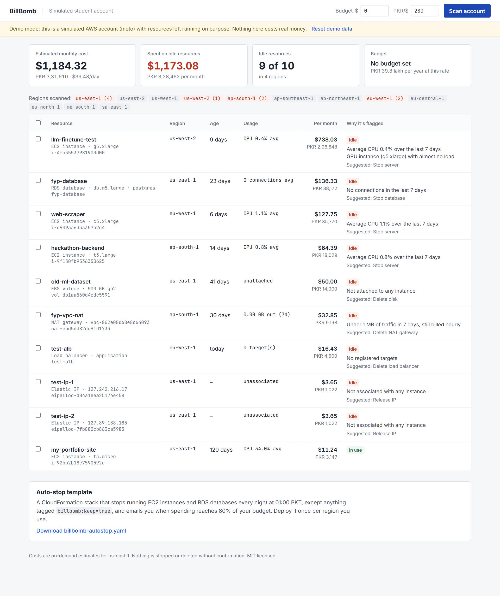

# 💣 BillBomb

**Find and defuse forgotten AWS resources before they blow up your bill.**

BillBomb scans every AWS region for servers, databases, disks, IP addresses and gateways you forgot about,
shows exactly what each one costs you (in dollars *and* rupees), explains why it looks abandoned, and
stops or deletes it with one confirmed click.

> Built solo for **Hacktoberfest Hackathon NUST × NSTP 2026**. Track 2: Developer Tools & Open-Source Infrastructure
> (*"Tools that simplify cloud infrastructure and development workflows"*).



---

## The problem

> *"launched a big AWS EC2 instance alongside AWS Bedrock... 2 weeks later, a bill for ~$1,700 showed up."*
> ([a developer on Hacker News, 2026](https://news.ycombinator.com/item?id=48528779))

The cloud bills by the hour, like an electricity meter that never switches off. Students and developers spin up a
server to "quickly test something", forget it, and find out a month later. The same thread found that many
people forget a running EC2 instance. It's one of the most common horror stories in tech, and AI workloads
(GPU instances, Bedrock, SageMaker) make bills explode faster than ever.

It's worse for students in Pakistan:

- **$1,700 ≈ PKR 4.7 lakh**, roughly a year of university fees, charged in dollars at a painful exchange rate, often to a parent's card.
- AWS has **30+ regions**. A server left in Oregon or Mumbai is invisible if your console is set to Virginia.
- "Free tier" makes people think everything is free. NAT gateways, Elastic IPs, GPUs and RDS are not.
- AWS Budgets only emails you *after* you've spent. It doesn't tell you *what* to turn off.

## What BillBomb does

| | Feature |
|---|---|
| 🛰️ | **Scans every region in parallel** for EC2 instances, EBS volumes and snapshots, Elastic IPs, NAT gateways, load balancers and RDS databases |
| 🧟 | **Idle detection from real usage**: CloudWatch says the server averaged 0.4% CPU for 7 days, or the database had zero connections |
| 💸 | **Cost summary**: estimated monthly, daily and yearly cost, spend on idle resources, and budget status, in **USD and PKR** |
| ✂️ | **Clean-up**: stop servers and databases, delete unattached disks, release IPs, delete idle NAT gateways and load balancers. Every action is listed and confirmed first, and live mode requires typing `DEFUSE` |
| ⏰ | **Auto-stop template**: a CloudFormation template that stops all servers and databases every night (01:00 PKT) unless tagged `billbomb:keep=true`, plus a budget email alert at 80% |
| 🧪 | **Demo account**: a simulated AWS account (via [moto](https://github.com/getmoto/moto)) seeded with realistic forgotten resources. Try everything with zero risk and no AWS account |

### What counts as idle

| Resource | Flagged when |
|---|---|
| EC2 instance | Running ≥ 2 days with average CPU < 2% over 7 days, or any GPU instance (g4/g5/p3/p4/p5…) left idle |
| RDS database | Running ≥ 2 days with zero connections over 7 days |
| EBS volume | Not attached to any server (you pay for every GB) |
| Elastic IP | Reserved but attached to nothing (all public IPv4 is billed since Feb 2024) |
| NAT gateway | Under 1 MB of traffic in 7 days (it still bills ~$33/month) |
| Load balancer | No registered targets behind it |
| EBS snapshot | Older than 90 days |

Resources in active use are listed too, in green, marked *"In use. Leave it alone."*, so you see the full bill.

## Architecture

```
            ┌──────────── every region, in parallel ────────────┐
 boto3 ───▶ │ scan_ec2   instances · CPU (CloudWatch) · volumes  │
 session    │            Elastic IPs · NAT gateways · snapshots  │──▶ findings ──▶ summarize()
            │ scan_rds   databases · connections (CloudWatch)    │    (cost,       USD · PKR · burn/day
            │ scan_elb   load balancers · target health          │     reasons,    days to budget
            └────────────────────────────────────────────────────┘     action)
                                                                         │
                         actions.defuse()  ◀── confirmed by user ── Flask UI (dashboard)
```

| File | Role |
|---|---|
| `billbomb/scanner.py` | Region discovery, parallel scanning, zombie rules, cost summary |
| `billbomb/pricing.py` | On-demand price table (us-east-1) with safe fallbacks for unknown types |
| `billbomb/actions.py` | Explicit per-resource stop/delete actions |
| `billbomb/demo.py` | Simulated AWS account seeded with forgotten resources (moto) |
| `app.py`, `templates/`, `static/` | Web UI and JSON API |
| `infra/autostop.yaml` | Auto-stop template: Lambda + nightly EventBridge rule + AWS Budget alert |
| `tests/` | pytest suite running the real scanner and actions against simulated AWS |

## Setup

```bash
git clone https://github.com/zaynabtauqeer/billbomb.git
cd billbomb
pip install -r requirements.txt
python app.py          # live mode if AWS credentials are configured, otherwise demo
python app.py --demo   # force the simulated demo account
```

Open **http://localhost:8080**.

**Live mode** uses your normal AWS credentials (`aws configure`, environment variables or SSO). For scanning only, a
read-only policy is enough: `ec2:Describe*`, `rds:DescribeDBInstances`, `elasticloadbalancing:Describe*`,
`cloudwatch:GetMetricStatistics`, `sts:GetCallerIdentity`. Defusing additionally needs the matching
stop/delete/release permissions. Credentials never leave your machine, and nothing is stored.

**Auto-stop template:** download the template from the app (or use `infra/autostop.yaml`) and deploy it in
CloudFormation in each region you use.

**Tests:** `python -m pytest` (runs entirely against simulated AWS, no account needed).

## Honest limitations

- Prices are **on-demand estimates for us-east-1** and ignore data transfer, reserved/spot pricing and free-tier credits.
  It's a smoke alarm, not an invoice.
- Covers the services behind most surprise bills (EC2, EBS, EIP, NAT, ELB, RDS). Not yet: SageMaker endpoints,
  OpenSearch, EKS, Bedrock provisioned throughput, S3 storage growth.
- The auto-stop template is syntactically checked but was not deployed during the hackathon (no AWS account was available).

## Related work, and how BillBomb differs

- **AWS Budgets / Cost Explorer**: alert *after* spending and don't say what to turn off.
- **aws-nuke / cloud-nuke**: delete *everything* in an account. Great for sandboxes, dangerous for students with one real project.
- **Komiser, Steampipe**: powerful inventory tools for teams, with more setup than a student will do at 2 a.m.

BillBomb is built for the individual student or developer: **find what's forgotten, prove it's unused, show the cost
in your currency, and remove only what you confirm.**

## Roadmap

- More services: SageMaker endpoints, Bedrock provisioned throughput, EKS, OpenSearch, S3 growth
- Real-time pricing via the AWS Pricing API, per region
- Scheduled scans with WhatsApp/email alerts
- Azure and Google Cloud scanners

## Team contributions

Solo project. Research, design, implementation, tests and documentation by
[@zaynabtauqeer](https://github.com/zaynabtauqeer). Developed with AI pair-programming assistance (Claude Code).

## Acknowledgements

- [boto3](https://github.com/boto/boto3) (Apache-2.0), [moto](https://github.com/getmoto/moto) (Apache-2.0),
  [Flask](https://flask.palletsprojects.com/) (BSD-3-Clause)
- Fonts: Chakra Petch, JetBrains Mono, Inter via Google Fonts (SIL OFL)
- Problem source: [Hacker News, "What are you working on?" (2026)](https://news.ycombinator.com/item?id=48528779)

## License

[MIT](LICENSE)
